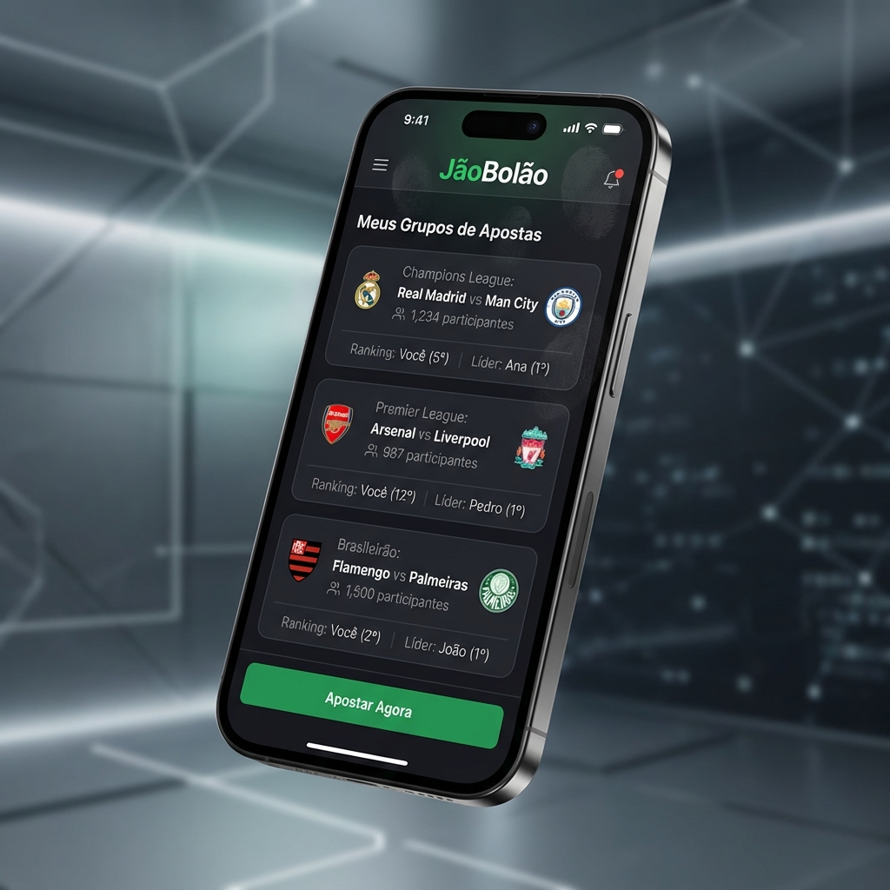
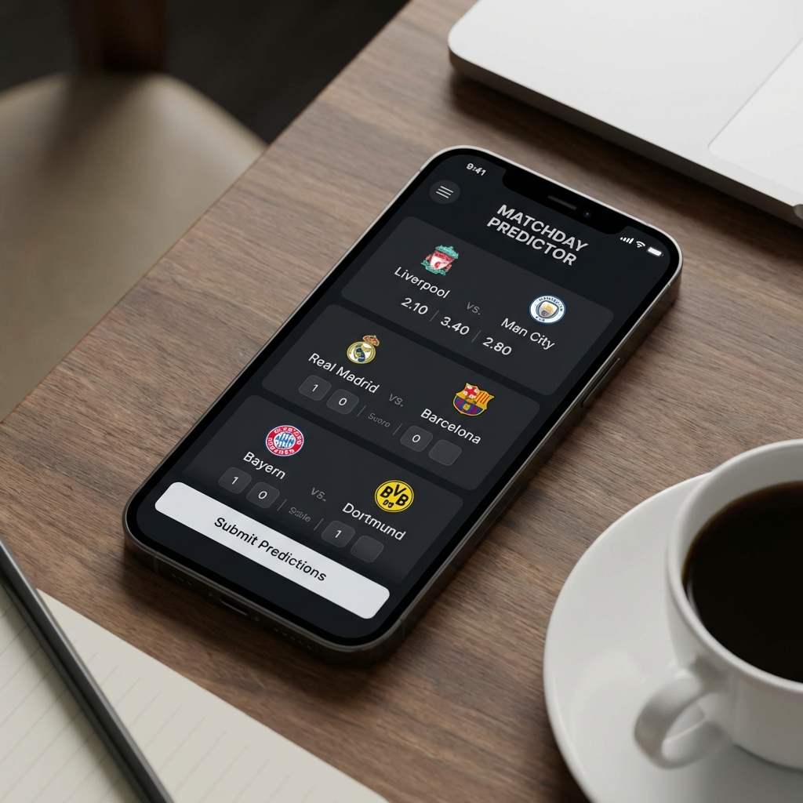
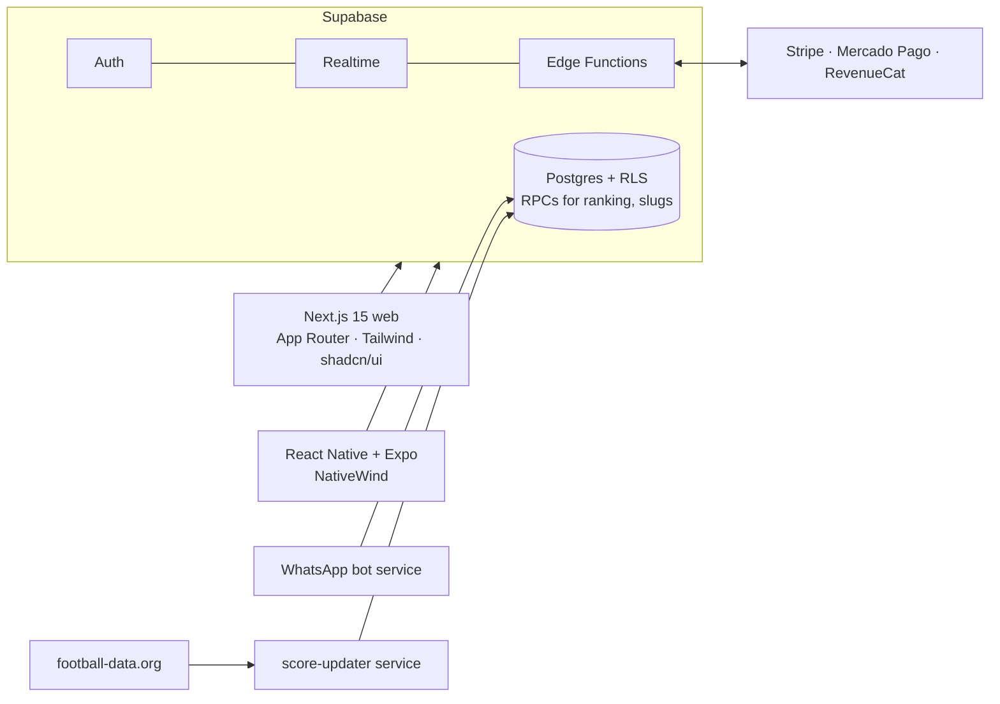

<div align="center">


# 🏆 JãoBolão

### A multiplatform platform for football prediction pools

*Create private or public pools, predict scores before kickoff, and watch an automated ranking update as results arrive.*


</div>

---

## What is it?

**JãoBolão** modernizes and gamifies football prediction pools among friends and communities. It is a full SaaS/B2C product:
web app, mobile app, real-time rankings, subscription plans, a WhatsApp bot and an admin/marketing console, all sharing one
monorepo and one Supabase backend.

> 🎨 The images below are **UI design mockups** used for the product pages, not live screenshots.

<p align="center">
  
  
  
</p>

## ✨ Features

- 🔐 **Authentication**: email, social login (Google/Apple) and magic link.
- ⚽ **Pool management**: private or public groups, custom scoring rules, invite links with friendly slugs, knockout-only pools.
- 📊 **Predictions and rankings**: predict before kickoff, predictions become visible after kickoff, ranking computed in SQL (`get_group_ranking` RPC).
- 🔄 **Auto sync**: matches and results updated from [football-data.org](https://www.football-data.org/) by Edge Functions and a score-updater service, including corrections such as penalty-shootout scores.
- 💳 **Subscriptions**: Free / Premium / Pro with different limits; Stripe and Mercado Pago on web, RevenueCat for in-app purchases.
- 🔔 **Notifications**: web push and mobile push tokens.
- 💬 **WhatsApp integration**: a bot service that posts results and rankings to a pool's group.
- 🛡️ **Security by default**: Row-Level Security on every table, with explicit migrations for missing policies.

## 🏗️ Architecture



```text
apps/web          Next.js 15 web app (+ admin and marketing console)
apps/mobile       Expo / React Native app
services/         score-updater, WhatsApp bot
supabase/         migrations (schema, logic, RLS, payments, WhatsApp), seed, scripts
```

## 🚀 Getting started

```bash
git clone https://github.com/pjaragao/J-oBol-o.git && cd J-oBol-o
npm install
# create apps/web/.env.local with your Supabase URL, anon + service-role keys, payment keys and football-data key
npm run dev                                      # Turborepo runs web (and mobile) in dev mode
```

Apply the SQL in `supabase/migrations/` to a Supabase project (or run `supabase db reset` locally). Setup details are in
[README_SETUP.md](README_SETUP.md).

---

<div align="center">

Built by **Paulo Aragão Jr** · [GitHub](https://github.com/pjaragao) · [LinkedIn](https://www.linkedin.com/in/paulojrarj)

</div>
