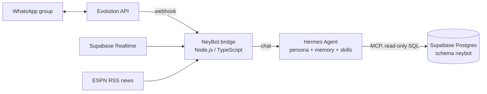
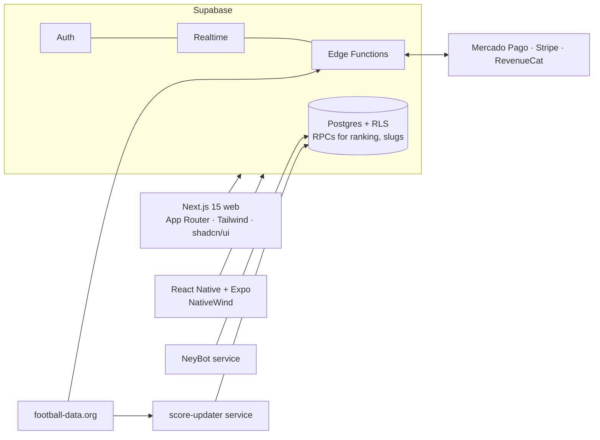

<div align="center">


# 🏆 JãoBolão

### A multiplatform platform for football prediction pools

*Create private or public pools, predict scores before kickoff, and watch an automated ranking update as results arrive.*


</div>

---

## What is it?

**JãoBolão** modernizes and gamifies football prediction pools among friends and communities. It is a full SaaS/B2C product:
web app, mobile app, real-time rankings, paid pools, an AI WhatsApp chatbot (**NeyBot**) and an admin/marketing console, all sharing one
monorepo and one Supabase backend.

## ✨ Features

- 🔐 **Authentication**: email, social login (Google/Apple) and magic link.
- ⚽ **Pool management**: private or public groups, custom scoring rules, invite links with friendly slugs, knockout-only pools.
- 📊 **Predictions and rankings**: predict before kickoff, predictions become visible after kickoff, ranking computed in SQL (`get_group_ranking` RPC).
- 💰 **Paid pools**: pools can have an entry fee, paid online through **Mercado Pago** (checkout preferences + signature-validated webhooks) or tracked offline. A financial service computes the prize pot, the platform fee and the net amount to distribute. Subscription tiers are also supported (Stripe checkout on web, RevenueCat on mobile).
- 🔄 **Two data sources**: match fixtures and results come from the [football-data.org](https://www.football-data.org/) API (Edge Function `sync-matches` + a `score-updater` service, including corrections such as penalty-shootout scores), and football news comes from ESPN Brasil RSS feeds for the chatbot.
- 🔔 **Notifications**: web push and mobile push tokens.
- 🛡️ **Security by default**: Row-Level Security on every table, with explicit migrations for missing policies.

## 🤖 NeyBot, the WhatsApp chatbot

**NeyBot** is the pool's AI assistant: cheerful, football-obsessed, and an expert on World Cup history. Tag `@NeyBot` in a pool's
WhatsApp group (or DM it) to ask about rankings, matches, rules or trivia. It also posts automatic goal and match notifications.



- **Bridge service** (`services/whatsapp-bot`): receives Evolution webhooks, detects mentions/DMs, handles account linking (`vincular <token>`), rate-limits, and forwards the conversation to the agent. It listens to Supabase Realtime to push goal and match alerts.
- **Hermes Agent** (`services/whatsapp-bot/hermes`): the LLM brain with persistent memory and two skills, `copas-history` (World Cup history) and `bolao-rules` (pool rules).
- **Safe data access**: the agent reads the database through MCP tools over a dedicated **read-only `neybot` schema**. Views expose only what is needed and **hide predictions for matches that have not started**, so nobody can copy another player's picks through the bot. It never invents scores: if a tool returns nothing, it says so.

## 🏗️ Architecture



```text
apps/web          Next.js 15 web app (+ admin and marketing console)
apps/mobile       Expo / React Native app
services/         score-updater, whatsapp-bot (NeyBot bridge + Hermes agent config)
supabase/         migrations (schema, logic, RLS, payments, WhatsApp), seed, scripts
```

## 🚀 Getting started

```bash
git clone https://github.com/pjaragao/J-oBol-o.git && cd J-oBol-o
npm install
# create apps/web/.env.local with your Supabase URL, anon + service-role keys, payment keys and football-data key
npm run dev                                      # Turborepo runs web (and mobile) in dev mode
```

Apply the SQL in `supabase/migrations/` to a Supabase project (or run `supabase db reset` locally). Setup details are in
[README_SETUP.md](README_SETUP.md).

---

<div align="center">

Built by **Paulo Aragão Jr** · [GitHub](https://github.com/pjaragao) · [LinkedIn](https://www.linkedin.com/in/paulojrarj)

</div>
